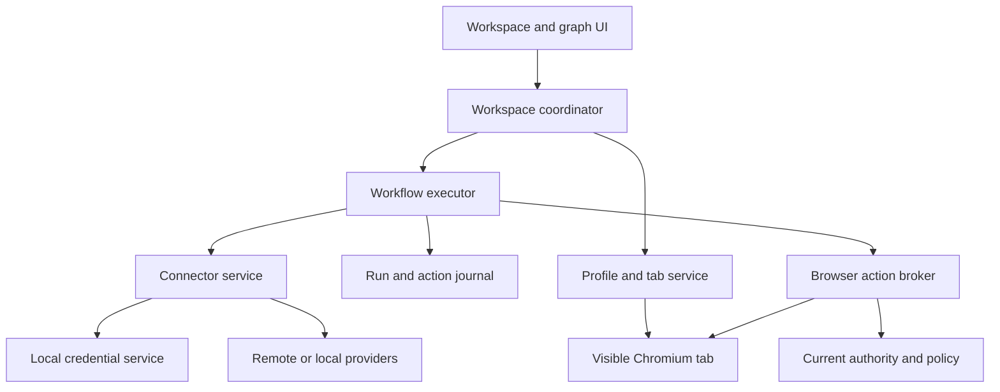

# Aimium architecture

## Product goal and current state

Aimium is intended to be a Chromium desktop browser for Windows, Linux and
macOS. A workspace pairs a normally usable website with a left context/AI
panel. The user can choose from several configured model connectors without
changing the website's logged-in identity. The assistant can observe and act on
the visible website, and the user can save repeatable tasks as versioned graphs.

P0 contains a feature-gated `chrome://aimium` foundation screen, versioned JSON
contracts, examples, Python reference validation and build/check tooling. **It
does not implement the left sidebar, persistent workspaces, provider calls,
browser automation, graph execution or scheduling.** The native screen's source
and browser tests require a complete Chromium build for acceptance; lightweight
checks do not establish that native compilation or platform tests passed.

The initial upstream identity is recorded in [upstream.json](../upstream.json).
It is a development snapshot, not a Stable release. A verified Stable base and
native platform evidence are prerequisites for a distributable product.

## Core identities

| Object | Responsibility | Lifetime |
| --- | --- | --- |
| Browser profile | Chromium-managed cookies, storage and website identity | Persistent until explicitly removed |
| Workspace | Website context, chosen profile, model selection and agent permissions | Saved user workspace |
| Connector | Provider endpoint, protocol adapter and local credential reference | Reusable local configuration |
| Model binding | Connector/model selection and required capabilities | Workspace setting; pinned for a run |
| Workflow version | Immutable graph with symbolic browser/model slots | Reusable definition |
| Run | One execution with resolved bindings, status and outcomes | Durable execution record |
| Action | One scoped request against a specific tab/document/observation | Recorded execution step |
| Site knowledge revision | Reviewed, origin-scoped observations and task knowledge | Versioned local knowledge; not implemented in P0 |

Profile identity must not be derived from a connector or model name. Switching
from a remote model to a local model should keep the same website session.
Conversely, separate accounts need deliberately separate profiles or other
explicitly designed browser partitions. A tab identifier alone does not isolate
cookies. Browser identity management must use Chromium's profile machinery,
including its normal lifecycle and shutdown behavior.

Workspaces and runs reference opaque profile IDs rather than user-data paths.
The future profile service owns the mapping. Development builds use their own
user-data directory. Product profile/install identity is a separate release gate
and has not been implemented in P0.

## Proposed process and service boundaries

The following is the target design. Boxes other than the initial WebUI entry
point and reference contracts are not implemented services.

The product should keep Chromium-specific integration narrow and put product
logic behind explicit interfaces. Native C++ services own browser state,
profile access, action authority and execution lifecycles. WebUI provides the
left panel and graph editing through typed browser IPC. The current Python
validator is a development/reference tool, not a Python backend to ship inside
the browser.

The website remains in a normal Chromium `WebContents`. The AI acts on the tab
the user sees. An iframe of the website inside a web app or an unrelated
headless session would not provide the required identity and visibility.
Implementing the sidebar therefore requires native browser layout integration;
the P0 `chrome://aimium` page is only an entry point for development.

### Workspace coordinator

The coordinator resolves a workspace to its browser profile and active tab,
tracks permitted origins, selects the model binding, and attaches the context
panel. Workspaces may reuse configured connectors, but browser-session lifetime
is independent of connection lifetime. A provider timeout must not destroy the
website session.

Human navigation, tabs closing, login expiry, profile shutdown and browser exit
must all reach the executor as explicit state changes. A manual interaction can
invalidate the assistant's observation even if the URL did not change. The
agent should pause or reobserve before continuing when its state is stale.

### Connector service

Use separate adapters for OpenAI, OpenRouter, Replicate and local/compatible
endpoints. A shared interface should cover capability discovery, text/image
input, structured output, tool proposals, cancellation, asynchronous jobs and
usage accounting where supported. Matching a request shape does not establish
identical semantics across providers. Adapter conformance tests belong in the
provider implementation milestone.

The run snapshots its model bindings. Provider changes are explicit; there is
no silent fallback that sends context to an additional company. An adapter
normalizes results and errors but cannot grant a browser permission. The action
broker accepts only typed proposals that pass policy checks.

Credentials are resolved locally through a credential service using suitable
Chromium/platform secret-storage facilities. Verify availability and behavior
on each supported desktop before making a storage-security promise. Credentials
must not enter prompts, page scripts, logs or workflow templates.

Context needs an explicit projection: selected page text, accessibility data,
optional screenshots, task instructions and approved site knowledge. Password
fields, cookies, storage tokens and unrelated tabs are outside that projection.
The UI must make the destination and context scope understandable. A loopback
endpoint is not proof of local inference; it may be a forwarding service.

## Browser actions and observations

Use a structured observation of the live page as the primary source for targets.
An observation records the tab/document/frame context and short-lived element
references. Accessibility information and bounded DOM-derived data can provide
semantic targets; screenshot/visual assistance can supplement them when needed.
The exact capture and frame model must be implemented and tested on a controlled
fixture site before external-site automation.

The broker owns any privileged inspection/interaction mechanism. It does not
expose unrestricted DevTools, arbitrary JavaScript evaluation, shell execution
or an external debugging port to the model. The v1 reference allowlist is
observe, click, fill, select, scroll, navigate and download. Additional operations
need explicit contract and policy changes.

Before execution, the broker validates the request against trusted state:

1. The run is active and owns the current action lease.
2. Workspace, profile and tab match the bound execution target.
3. Document generation, origin and observation are still current.
4. The action and destination are within the run's effective permissions.
5. The element still belongs to the intended document/frame and is actionable.
6. Budgets and any required user confirmation are satisfied.

The Python `ActionAuthority` check covers the identity, generation and declared
scope part of this design. It cannot inspect a real tab, enforce a lock, grant a
permission, account for redirect chains or prove that an element is current.
Those are browser-service responsibilities.

Only one run should hold the writing lease for a tab. Lease generations change
on cancellation, ownership change and other invalidation events, so a delayed
model response cannot resume an obsolete authority. Because two tabs can still
share one remote account, account/resource locks and overlap policies are also
needed for workflows that affect the same external state.

Every mutating action declares an expected result. The broker observes the
result before advancing. An expired login pauses for the user; solving account
challenges or submitting sensitive data is not implicitly authorized by a
generic ability to click. Permission policy should distinguish reading,
preparing a change and committing an external effect. The workflow's declared
action allowlist is only one input to that policy.

Page content, model output and imported workflow text are untrusted data. A
website can display instructions that conflict with the user's task. Those
instructions must not modify connector destinations, expand origin permissions,
extract credentials or create new authority. Protect the boundary in browser
code; adding a sentence to a prompt is insufficient.

## Workflows, persistence and recovery

The reference [workflow contract](../contracts/workflow.schema.json) describes
a sequential outer graph with explicit branching. Each definition has a
`schema_version` and an immutable `(workflow_id, version)` identity. A visual
editor will produce this document and display validation errors before a run
can begin. Reusing a process does not reuse browser cookies or provider secrets.

Bounded `for_each` nodes call pinned body workflows. Arbitrary graph cycles and
script nodes are excluded from v1. Nested calls must share effective permission
and execution budgets with their parent. The future registry loader must reject
indirect recursive dependencies and validate body inputs before activation.
The current validator checks individual documents, direct recursion and data
availability on all paths; it does not load a dependency registry.

The executor requires a durable local store for definitions, bindings, runs,
events and actions. Before an external effect, persist the action intent with
its ID. After it, persist the observed outcome. Resume from recorded facts, not
from whatever the last assistant message appeared to say. Model responses,
screenshots and extracted data need explicit retention and redaction rules;
they do not all belong in a log by default.

An action can succeed remotely while its response is lost locally. The v1 run
contract therefore includes `needs_reconciliation` and retains the unresolved
action ID. A restart, timeout or cancellation must not automatically repeat an
unknown write. Reobserve the relevant external state, use a service's reliable
idempotency mechanism where available, or ask the user to resolve the ambiguity.
A browser action system cannot generally promise exactly-once effects on
arbitrary websites.

P0 validates a run snapshot, not legal transitions between all snapshots. A
runtime event store must enforce transition ordering, monotonic sequence values,
action deduplication, immutable definition storage and crash recovery. Those are
acceptance requirements for the workflow-executor milestone.

### Site knowledge

"Learning a website" means building scoped, revisioned task knowledge: useful
page descriptions, supported actions, extraction expectations and repairable
locators/strategies. It does not mean automatically training a model on browsing
history. Knowledge should be origin/account scoped, removable and reviewable,
with provenance and a last verification time. Revalidate it after site changes.
Runs should pin the relevant knowledge revision when this subsystem is added.

## Scheduling and events

Scheduling comes after durable execution and recovery. A local scheduler cannot
execute while the machine or runtime is off. The product must choose whether it
requires an open browser, an explicit background process or a separately managed
runner, and state this clearly in the UI.

Each trigger needs a timezone, missed-trigger policy, concurrency/overlap rule,
deduplication identity, maximum backlog and a fixed workflow version. Repeated
events need debouncing/coalescing where appropriate. Website-change events must
have a defined observation mechanism; they cannot be assumed to arrive when no
page is loaded. Run cancellation and disabled schedules revoke new execution
authority without pretending to undo already completed remote effects.

No schedule, event-source schema, background service or operating-system startup
integration is implemented in P0.

## Keeping Chromium maintainable and lean

Keep product-owned code in `aimium/` and narrowly scoped native Aimium targets.
Make upstream modifications at clear registration, resource and layout points.
Prefer existing feature flags and platform services to copying large Chromium
subsystems. Record each base revision and upgrade on a dedicated branch with
repeatable validation; see [development](development.md).

Reduce default UI and optional product integrations deliberately. First measure
startup, memory, disk usage and dependency footprint, then identify a concrete
component whose removal has a justified benefit. Removing broad parts of
Chromium without dependency analysis makes upgrades and website compatibility
harder. The sandbox, site isolation, security checks, certificate verification,
browser update path and ordinary website/session behavior remain necessary
engineering requirements.

P0 removes no Chromium subsystem. A later slimming change must document the
user-visible behavior, feature dependencies, measured effect, patch size and
platform/regression tests. Avoid conflating a hidden UI entry with a component
that is no longer built or running.

The first release requires a verified Stable base, distinct product identity,
working update delivery, signed platform artifacts, applicable notices and
native tests. A feature-gated development page and green Python checks cannot
substitute for that evidence. The [roadmap](roadmap.md) separates source
foundation from accepted runtime and release milestones.
